# SZR Autostrad

Three 3D driving games that run in the browser, set on real roads in three Arab cities:

- **لفّة عمّان (Amman Loop):** a 22 km loop over the hills of Amman, past Abdali, the King Abdullah I Mosque, the Citadel, the Raghadan flagpole, the Roman Theatre, Rainbow Street, Abdoun Bridge, the 7th Circle and Mecca Mall.
- **لفّة دبي (Dubai Loop):** a 47 km loop at sunset, down Sheikh Zayed Road past the Dubai Frame, the Museum of the Future, Emirates Towers, Burj Khalifa and Mall of the Emirates to the Marina and Ain Dubai, then back along Jumeirah past Burj Al Arab and Jumeirah Mosque.
- **لفّة الرياض (Riyadh Loop):** a 43 km loop on a hot, hazy afternoon, from Masmak Fort and the Grand Mosque in the old town past Murabba Palace, the Water Tower and the TV Tower, up King Fahd Road past Al Faisaliah and Kingdom Centre to the financial district, then west past Riyadh Park and Boulevard City to old Diriyah and back.

Each city has its own look. Amman has white and beige stone houses stacked up the hills on both sides of the road, with balconies, black and white water tanks, solar heaters and dishes on the roofs, and steel bars left on top for the next floor. Dubai has a wall of glass towers along Sheikh Zayed Road that mirror the sunset sky, the Metro running beside the road on its raised track with gold stations and a moving train, and green lawns and palms along the road. Riyadh has low mud colored Najdi walls with pointed tops in the old town, glass and stone towers along King Fahd Road with the blue Metro line on its raised track beside it, walled beige villas with palms, and the mud brick lanes of Diriyah.

The cars have shiny paint that reflects the sky, rounded bodies, wheel arches and five spoke wheels.

The games come in English and Arabic. The Arabic text uses each city's own dialect (Jordanian, Gulf and Najdi), and the layout flips right to left.

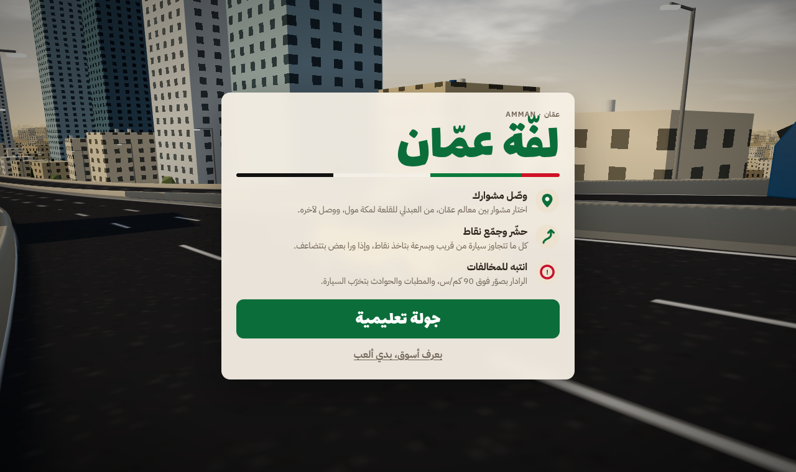

| Amman | Dubai |
| --- | --- |
| 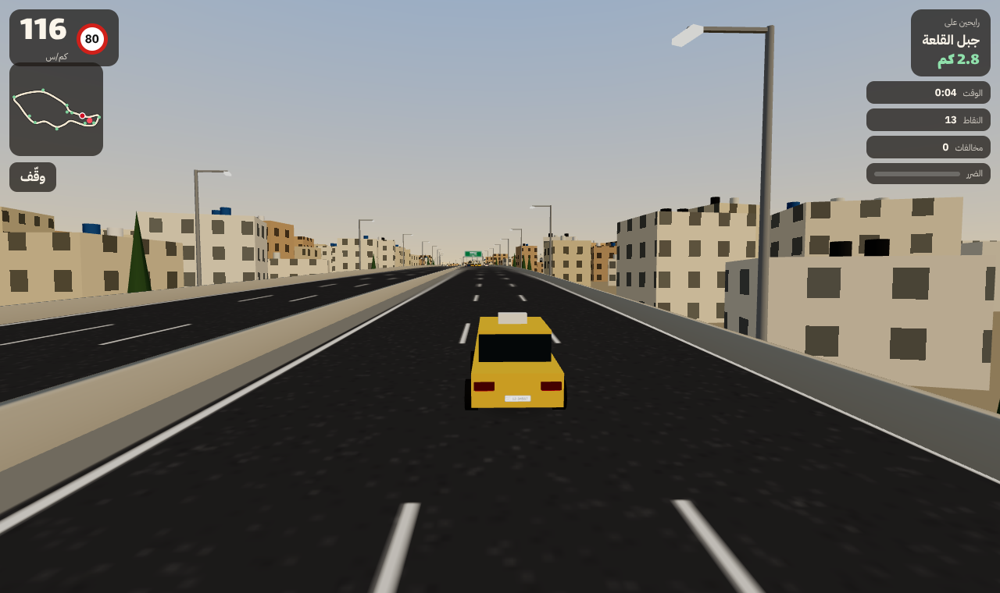 | 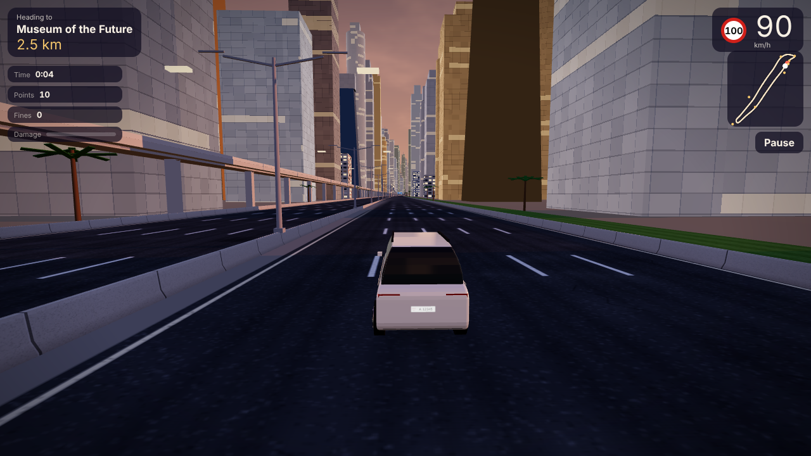 |
| 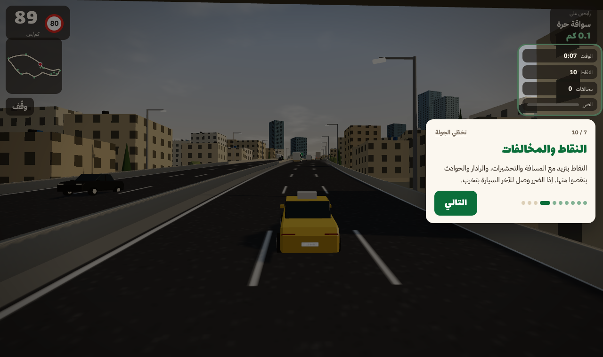 | 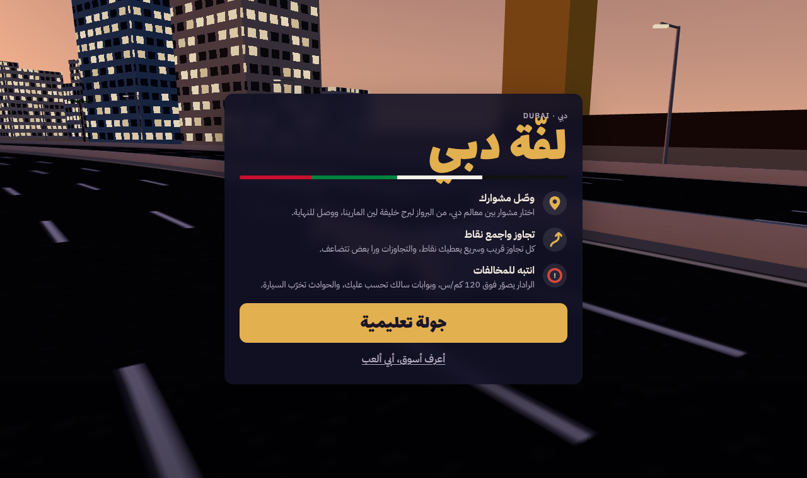 |

| Riyadh | |
| --- | --- |
| 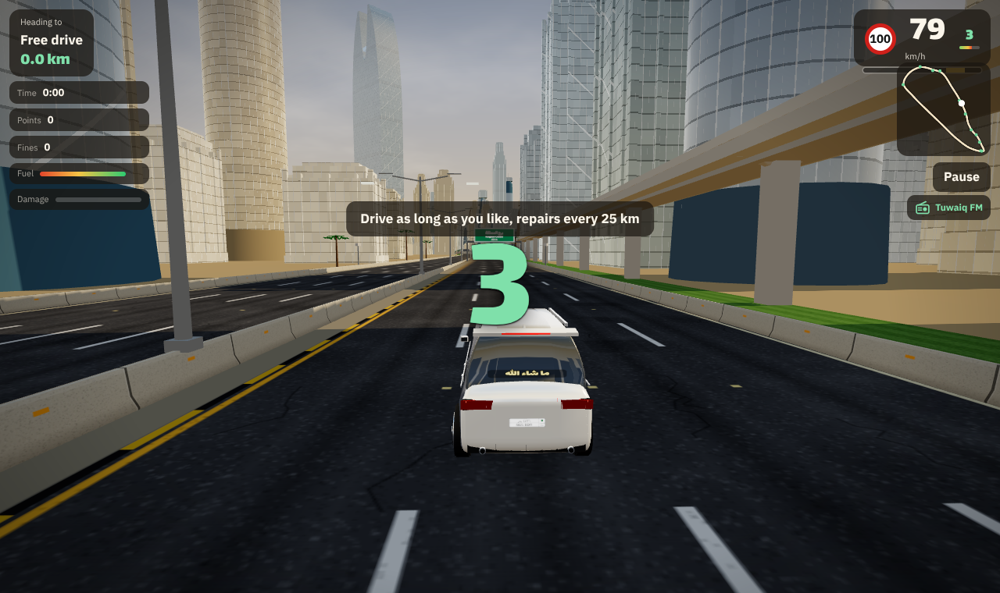 | 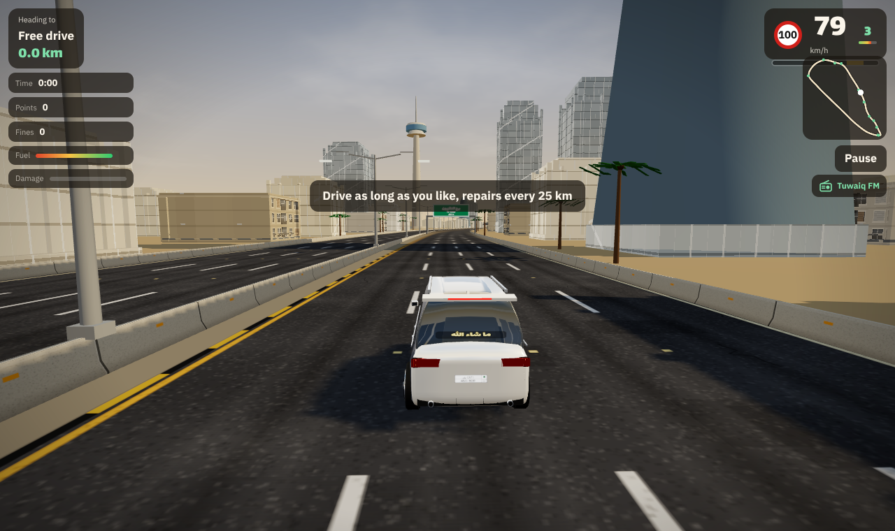 |

**Version 2.14** (October 2026). See [What's new](#whats-new) for the changes.

On a phone it plays upright or sideways, with a touch stick and a horn button:

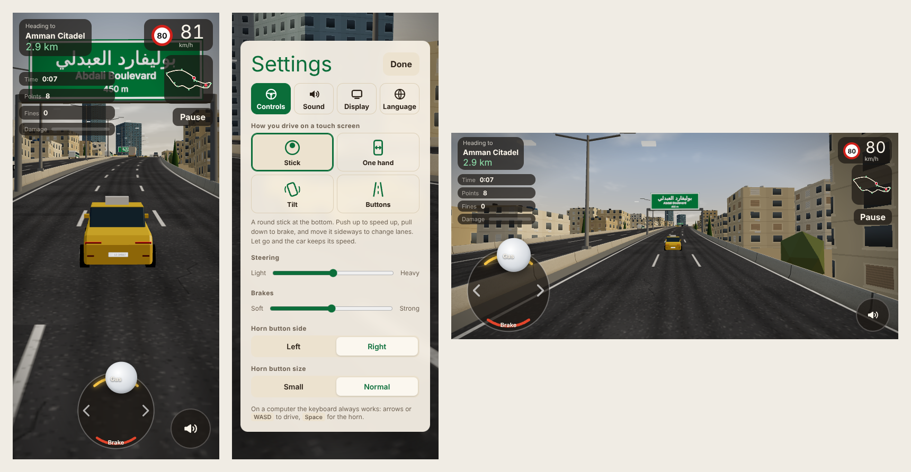

## Play

**Play online:** https://njarrar.github.io/SZR-Autostrad/

The page lets you pick a city. Each game also has its own address:

- Amman: https://njarrar.github.io/SZR-Autostrad/amman/
- Dubai: https://njarrar.github.io/SZR-Autostrad/dubai/
- Riyadh: https://njarrar.github.io/SZR-Autostrad/riyadh/

They work on a computer or a phone, upright or sideways.

To play offline:

1. Download or clone this repo.
2. Open `dist/amman.html`, `dist/dubai.html` or `dist/riyadh.html` in Chrome, Edge, Safari or Firefox.

That's it. Each game is one file. It needs an internet connection the first time to load three.js and the fonts.

If your browser blocks local files, serve the folder instead:

```bash
npx http-server dist
```

Then open the address it prints and pick `amman.html`, `dubai.html` or `riyadh.html`.

## Language

The game picks English or Arabic from your browser language. Press the language button at the top of the menu or the welcome screen to switch. Your choice is saved, and you can also add `?lang=en` or `?lang=ar` to the address.

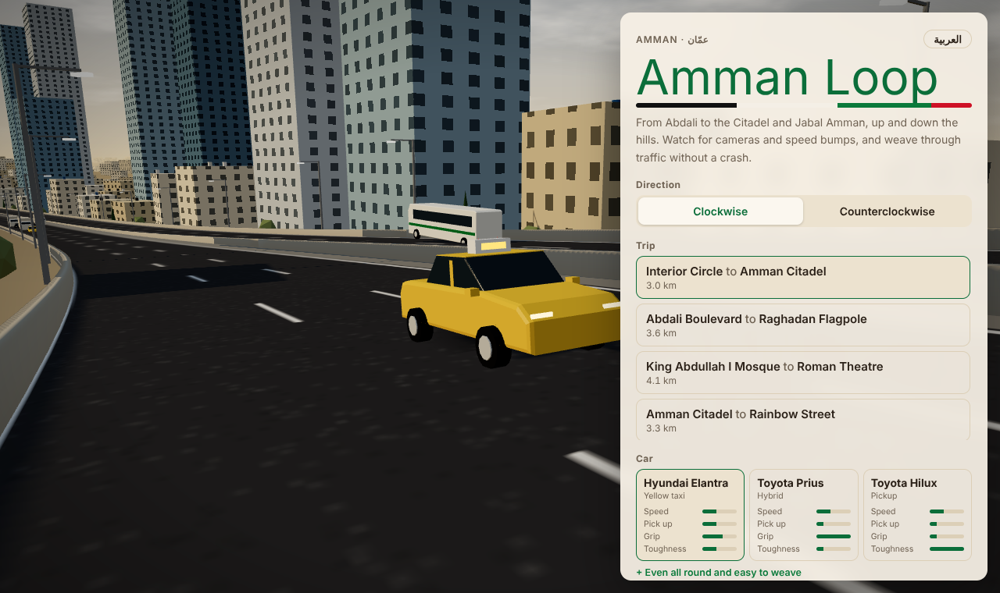

## First time playing

The game opens with a welcome screen that explains the three things to know. Press **Guided tour** (**جولة تعليمية** in Arabic) for a one minute tour on an empty road. The tour asks you to try each control (gas, changing lanes, braking and the horn), waits until you do it, then points at each part of the screen and explains it. Crashes and fines don't count during the tour. You can start the tour again at any time from **More options** in the menu with **How to play** (**كيف ألعب؟**).

## Controls

The car drives on its own and keeps its speed. You speed it up, slow it down and change lanes.

| Action | Keyboard | Phone (stick) |
| --- | --- | --- |
| Speed up | Hold `↑` or `W` | Push the stick up |
| Slow down or stop | Hold `↓` or `S` | Pull the stick down |
| Change lane | `←` `→` or `A` `D` | Push the stick left or right |
| Horn | `Space` or `H` | Round horn button |
| Nitro | `N` or `Shift` | N₂O button above the horn |
| Change camera | `C` | Settings > Display |
| Next radio station | `R` | Radio button, then pick a station |
| Radio on or off | `M` | Radio button, then Radio off |
| Pause | `P` or `Esc` | Pause button |

Let go and the car holds its current speed. A quick tap left or right moves you one lane over, and the car settles in the middle of that lane. Hold it to cross several lanes.

The stick lights up as you push: the yellow arc fills as you speed up, the red arc as you brake, and the arrows glow when you change lanes. A push that is mostly up or down won't change lanes by mistake. On phones that support it, you feel a small tick when you start to speed up or brake and when you move a lane. Let go and the knob springs back to the middle.

### Settings

Open **Settings** from **More options** in the menu, or from the pause screen. It has four tabs:

- **Controls**: pick how you drive on a touch screen, set how light or heavy the steering feels and how hard the brakes bite, and move or shrink the horn button.
  - **Stick**: a round stick at the bottom (under your left thumb when the phone is sideways).
  - **One hand**: put your thumb anywhere on the lower screen and drag.
  - **Tilt**: turn the phone like a steering wheel to change lanes, and drag up or down to change speed. On iPhone the game asks for motion access the first time.
  - **Buttons**: arrow buttons for lanes, plus gas and brake pedals.
  - **Wheel**: a steering wheel you turn with one thumb, with gas and brake pedals on the other side. Let go and it springs back to the middle.
- **Sound**: sound on or off, separate volumes for the engine, horn, effects and radio, radio music on or off, the horn sound (normal, deep, truck or a tune), and how strong the phone vibrates (off, light, normal or strong).
- **Display**: graphics quality, auto quality, time of day (auto, morning, afternoon, sunset or night), weather (winter rain in Amman, a sandstorm in Dubai, a dust storm in Riyadh), camera distance, speed effects and the map. With auto quality on, the game draws fewer pixels when it runs slow, then drops the shadows if it still can't keep up.
- **Language**: English or Arabic.

## Sound and radio

Every sound is made live in the browser. There are no sound files.

- **Engine.** Each car has its own engine sound. The Hilux sounds like a diesel, the Patrol like a big V8, the Huracán screams, and the Prius hums. The Accent buzzes like a small four cylinder. The engine climbs through the gears as you speed up, and you hear each shift. The gear and a rev bar sit next to your speed.
- **Road.** Tyre roar and wind grow with your speed, the tyres squeal when you brake hard or take a curve too fast, and the city hums in the background.
- **Traffic.** You hear cars whoosh past on the side they pass you. A car stuck behind you honks, and horns sound from where the car is.
- **Crashes.** A thump, crunching metal and, on a big hit, breaking glass.
- **Radio.** Press the radio button next to the pause button to open a short list of the city's three stations and **Radio off**, then tap the one you want. A line across the radio icon means it's off. On a keyboard, press `R` for the next station or `M` to turn the radio on or off. The music is made up as you drive from Arab rhythms (maqsum, baladi, khaleeji, the Najdi samri and ardah, and more) and maqam scales, so every trip sounds a little different. The radio gets quieter while you honk or get flashed by a camera.

| Amman | Dubai |
| --- | --- |
| Dawar FM: qanun over a maqsum beat | Creek FM: oud over a khaleeji beat |
| Jabal Radio: nay over a dabke beat | Marina Nights: dance beat with a synth lead |
| Downtown Beats: synth over a baladi beat | Desert Wind: slow nay in maqam saba |

| Riyadh |
| --- |
| Tuwaiq FM: oud over a samri beat with hand claps |
| Olaya Nights: Saudi pop with a synth lead |
| Najd Drums: the slow ardah march with a one string rababa |

Each trip starts with a 3, 2, 1 countdown. On phones that support it, you feel a buzz on crashes, close passes, camera flashes and lane changes.

## How to play

1. **Pick a trip** with the arrows: from one landmark to another, a full lap, or free drive with no end.
2. **Pick your car** (see below).
3. **Press Let's go.** Press **More options** first if you want to change the direction (clockwise or counterclockwise), the traffic (light, normal or heavy), or open the garage, album, settings or tour.
4. **Drive to the end of the trip.** The box at the top shows where you're going and how far is left. The map shows you, the landmarks and your destination.

### Cars

Each city has the cars you see on its roads every day. Each one has four bars on the menu: speed, pick up, grip and toughness, plus what it does well and badly. On a phone the bars for the chosen car sit under **More options**.

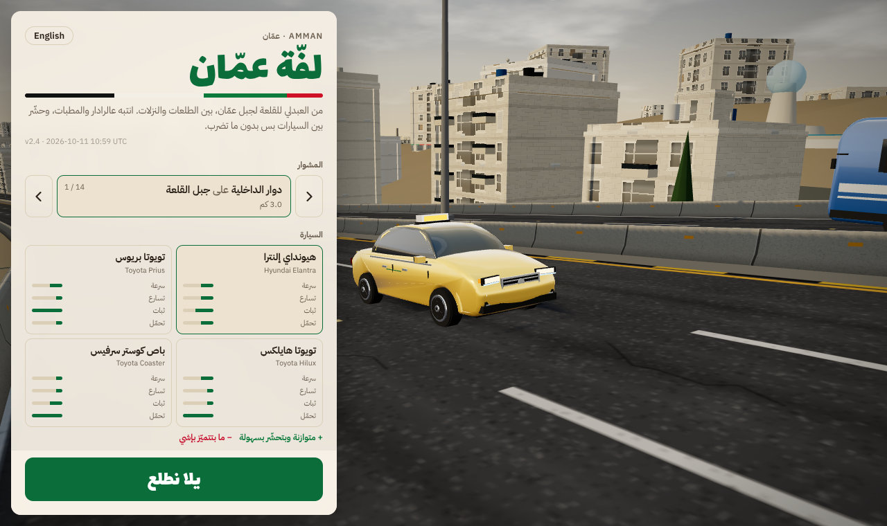

**Amman**

| Car | Top speed | Good at | Weak at |
| --- | --- | --- | --- |
| Hyundai Elantra (yellow taxi) | 175 km/h | Even all round, easy to weave | Nothing stands out |
| Toyota Prius | 165 km/h | Best grip in curves | Slowest pick up, takes the most damage |
| Toyota Hilux | 160 km/h | Takes the least damage | Slow and heavy in curves |
| Toyota Coaster (service bus) | 150 km/h | Carries up to 14 passengers | Wide and heavy to weave |
| Lana BMW (BMW 3 Series) | 215 km/h | Fast, quick to pick up and sure in curves | Low and soft, so bumps and crashes hurt |

**Dubai**

| Car | Top speed | Good at | Weak at |
| --- | --- | --- | --- |
| Nissan Patrol | 210 km/h | Tough, shrugs off crashes | Heavy and hard to turn |
| Lamborghini Huracán | 300 km/h | Fastest and best grip | One crash hurts a lot |
| Toyota Camry (taxi) | 190 km/h | Even all round, carries 4 passengers | Nothing stands out |
| Toyota Coaster (minibus) | 165 km/h | Carries up to 14 passengers | Wide and heavy to weave |

**Riyadh**

| Car | Top speed | Good at | Weak at |
| --- | --- | --- | --- |
| Toyota Land Cruiser | 205 km/h | Tough, shrugs off crashes | Heavy and slow to turn |
| Toyota Hilux | 175 km/h | Takes the least damage | Slow and loose in curves |
| Toyota Camry (white taxi) | 185 km/h | Even all round, carries 4 passengers | Nothing stands out |
| Hyundai Accent | 170 km/h | Light, good grip, easy to weave | Slow to pick up |
| Toyota Coaster (minibus) | 155 km/h | Carries up to 14 passengers | Wide and heavy to weave |

Damage from crashes, the barrier and speed bumps grows or shrinks with the car's toughness.

### Passengers, fares and fuel

The taxis and the Coaster bus work a service shift. Green stops wait near each landmark.

- Keep to the right lane and slow below 75 km/h as a stop comes up. The car pulls onto the shoulder and stops by the shelter.
- People on board climb out and walk off, then the ones waiting walk over and get in. The car sets off again once they are all in. Each drop pays a fare, and fares add points.
- Press the gas to skip a stop. Drive past and the people are left waiting.

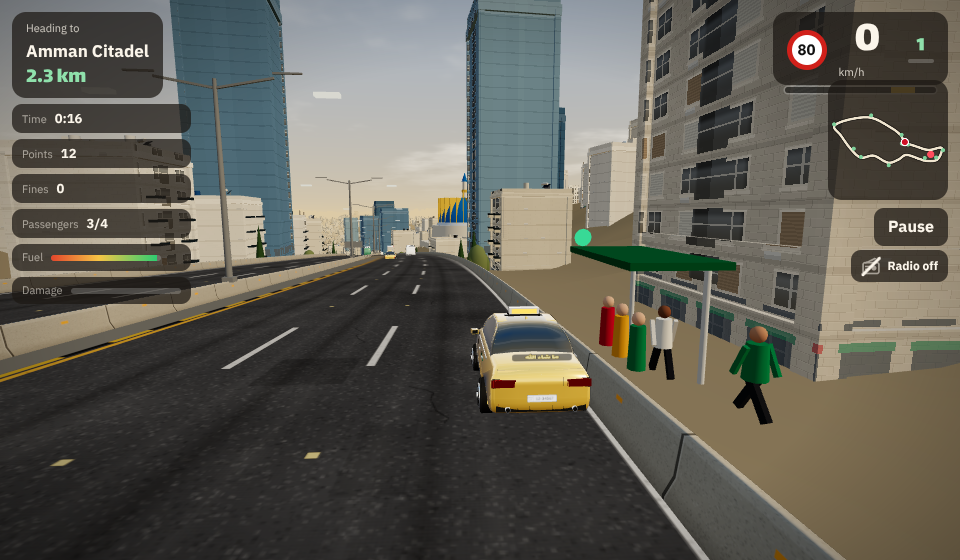
- The taxi carries 4 people. The bus carries 14, but each fare pays less.
- Every car burns fuel, faster on the gas and with nitro. The bar under your speed shows what is left. If the tank runs dry, the car limps at half speed.
- Fuel stations stand beside the road every 4.8 km. Pass one to fill up and fix some damage.

### Haitham Mode

Leave the car and walk. Press **Haitham Mode** next to the start button in the menu, in any city. Haitham sets off on the sidewalk beside the ring road at walking speed, 5 km/h, and has to reach the corner shop 400 m away.

- People walk toward you and ahead of you, kids run about, street sellers stand by their carts, and rubbish bags, bins, boxes and banana peels lie in the way. Trees are kept off the sidewalk, but bus shelters, poles and fuel pumps still stand on it.
- Left and right move you across the sidewalk. Up walks a little faster, 7.5 km/h, and down stops you.
- The horn (Space) says "excuse me". Most people ahead step aside; some are on their phone and don't.
- Nitro (N or Shift, or the N2O button) sets a street dog on Haitham's heels, and he runs at 16 km/h until the dog gives up. The gauge starts half full and fills as you slip past things. Running is fast but makes bumps easy.
- Treats float on the pavement every 40 m or so, with a gold ring under them. Walk into one to pick it up, and each pays 50 points:
  - **Falafel sandwich:** takes one bump off your count and tops up the nitro.
  - **Lemon and mint juice:** Haitham walks faster for 10 seconds.
  - **Coffee:** for 8 seconds everyone ahead makes way, even the people on their phone.
- Each bump costs points and stops you for a moment. A banana peel spins you round. After 6 bumps Haitham gives up and goes home.
- Points come from the distance you walk and from slipping close past people and things without touching them, more for a chain of them.
- People talk back in the city's own dialect, and the sellers call out what they sell: ka'ak and corn in Amman, karak tea in Dubai, dates and coffee in Riyadh.

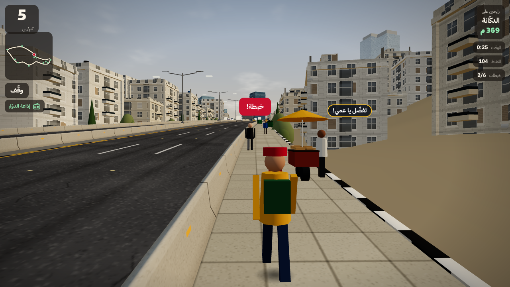

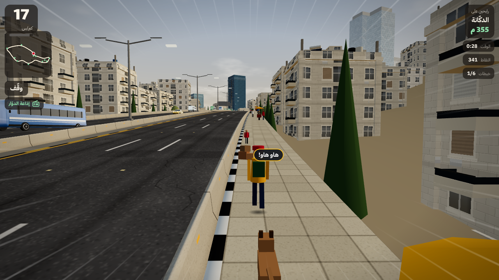

### Garage

Open **Garage** under **More options** in the menu to change the paint, the plate, a neon glow under the car, a sticker on the back window and a charm that swings from the mirror. Drag across the road to spin the car.

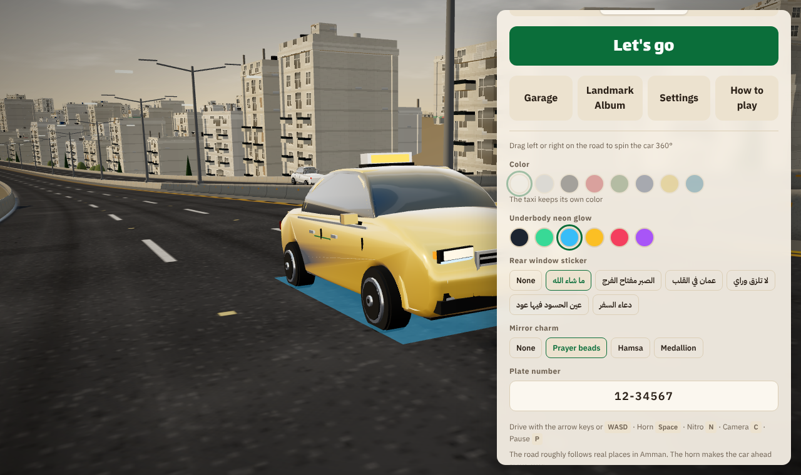

### Landmark album

Drive past a landmark to collect its postcard. Open **Landmark Album** under **More options** in the menu to see the ones you have.

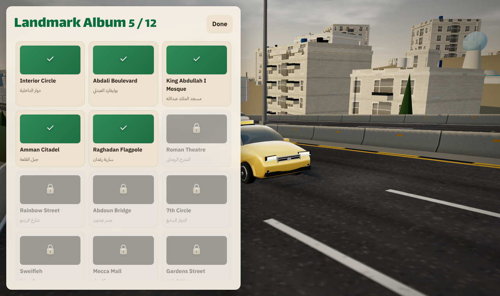

### Points

- You earn points for every kilometer you drive.
- Pass a car close and faster than it to earn bonus points. Passes in a row multiply the bonus.
- Every 10 km gives 500 bonus points.
- Road events pay extra points (see below).
- Passenger fares pay extra points.

### Nitro

Fill the nitro gauge under your speed by passing cars close or by driving right behind a car. Once it is a quarter full, press `N` (or the N₂O button) for a burst of speed. Fire it while the gauge sits in the gold part for a **perfect nitro**: a stronger push and 150 points. After the burst the car eases back to the speed you had.

### Road events

About once a minute something happens on the road:

- **Ambulance.** You hear a siren and see red and blue light behind you. Move out of its lane before it reaches you for 250 points. Block it and you get nothing.
- **Wedding convoy.** Three white cars with flowers drive slowly in the next lane and honk in rhythm. Pull up next to each one and honk for 100 points ("Mabrook!").
- **Tailgater.** A dark car sits right behind you and flashes its lights. Move over and let it pass for 120 points.

### Watch out for

- **Speed cameras.** A yellow warning shows before each one. Amman fines you above 90 km/h (80 limit plus 10). Dubai and Riyadh fine you above 120 km/h (100 limit plus 20). The faster you go, the bigger the fine:

  | Over the limit | Amman | Dubai | Riyadh (Saher) |
  | --- | --- | --- | --- |
  | 11 to 20 km/h | 15 JD | no fine | no fine |
  | 21 to 30 km/h | 25 JD | 300 AED | 800 SAR |
  | 31 to 40 km/h | 50 JD | 600 AED | 1,200 SAR |
  | 41 to 50 km/h | 50 JD | 700 AED | 1,500 SAR |
  | 51 to 60 km/h | 100 JD | 1,000 AED | 3,000 SAR |
  | over 60 km/h | 100 JD | 2,000 AED | 3,000 SAR |

- **Crashes.** Hitting a car costs a fine (20 JD in Amman, 400 AED in Dubai, 300 SAR in Riyadh) and damage, and ends your pass streak. Cameras and crashes never take away points.
- **The barrier.** Scraping it slows you down and adds damage.
- **Speed bumps (Amman).** Take them under 35 km/h.
- **Salik gates (Dubai).** Each one adds 4 dirhams to your trip.

If damage reaches 100% the car breaks down and the trip ends. In free drive, the car gets repaired every 25 km.

### Tips

- Sound the horn behind a slow car. It moves over if the lane next to it is free.
- Curves only push you outward when you take them faster than your car's grip allows.
- The garage lets you change the car's color and your plate number.
- On a slow phone, set graphics to **Fast** in Settings > Display. It turns off shadows and draws fewer pixels.

## What's new

### 2.14 (October 2026)

- **Phone and tablet apps.** The `ios/` and `android/` folders hold apps of all three cities for iPhone, iPad, Android phones and Android tablets. They carry three.js and the fonts inside, so they play with no network, run full screen, and keep the screen on while you drive. See [Phone and tablet apps](#phone-and-tablet-apps).

### 2.13 (October 2026)

- **Treats in Haitham Mode.** Pick up a falafel sandwich, a lemon and mint juice or a coffee off the pavement. Falafel forgives a bump, lemon juice speeds Haitham up, and coffee makes everyone step aside.

### 2.12 (October 2026)

- **Haitham's nitro.** Nitro in Haitham Mode now sends a barking street dog after him, and he runs for it until the dog gives up and trots off.
- **Kerb on the road side.** The black and white (yellow and black in Riyadh) kerb stones now run along the road edge of the sidewalk instead of the far side.

### 2.11 (October 2026)

- **Haitham Mode.** A walking game in every city. Haitham walks 400 m along the sidewalk to the corner shop and has to get past people, kids, street sellers and rubbish. The horn says "excuse me", and people answer in the local dialect.
- **Sidewalks.** Every road now has a paved sidewalk outside the barrier with a painted kerb, so you also see it while driving.

### 2.10 (October 2026)

- **Passengers get on and off.** At a stop the taxi or Coaster now pulls over and stands still. You see people step out and walk away, then the ones at the shelter walk to the door and get in, in Amman, Dubai and Riyadh. Before, they just vanished as you drove past.

### 2.9 (October 2026)

- **Riyadh.** A third city: a 43 km loop from Masmak Fort up King Fahd Road past Al Faisaliah and Kingdom Centre, out to Boulevard City and Diriyah, and back. It has eleven new landmarks, Najdi mud walls in the old town, towers and the blue Metro line along King Fahd Road, and a dust storm in the weather setting.
- **Riyadh cars.** The cars you see most there: Land Cruiser, Hilux, a white Camry taxi, Hyundai Accent and the Coaster bus. Traffic is mostly white SUVs and pickups, with maroon city buses. Plates are Saudi, with Arabic on top and Latin below.
- **Riyadh sound and talk.** Three new radio stations built on Najdi samri and ardah rhythms, one with a one string rababa. Saher cameras, a deeper SUV horn, and Arabic text and passenger lines in the Najdi dialect ("وسّع يا شيخ!", "كفو!").

### 2.8 (October 2026)

- **Fairer fines.** Speed camera fines now grow with how far over the limit you are, the way real cameras work. A small slip in Amman costs 15 JD instead of 30, and in Dubai 300 AED instead of 600. Crashes cost 20 JD in Amman (was 50) and 400 AED in Dubai (was 500).

### 2.7 (October 2026)

- **Lana BMW.** Amman has a fifth car, a BMW 3 Series called **Lana BMW** (سيارة لانا in Arabic). It has twin kidney grilles, a blue and white badge on the hood, a smooth six cylinder engine sound with eight gears, and the best top speed in Amman. Pick it in the Garage.

### 2.6 (October 2026)

- **Radio keys.** Press `R` for the next station and `M` to turn the radio on or off, so you don't need the mouse while driving.
- **Signs read right.** Road signs seen from behind, across the road, now show a plain metal back instead of mirrored writing.

### 2.5 (October 2026)

- **Easier radio.** The radio button now opens a short list: each station, then **Radio off**. The station that's playing is marked, and a line across the radio icon shows when it's off. Before, each tap moved to the next station, so turning it off meant tapping through all of them.

### 2.4 (October 2026)

A shorter menu and a cleaner screen on phones.

- **Shorter menu.** The menu now shows only the trip and the car, then **Let's go**, so it fits on a phone without scrolling. Trips show one at a time with arrows and a count, like "3 / 14". Direction, traffic, the garage, the album, settings and the tour sit under **More options**. **Let's go** stays at the bottom of the menu, even when you scroll.
- **Cleaner phone screen.** The six stat boxes are now one slim strip with icons for time, points, fines, passengers, fuel and damage. Pause and the radio are small icon buttons, and the map is smaller. This works with the phone upright or sideways.
- **One place for messages.** Hints like "Passengers aboard" and notices like "Lowered the quality" show in one spot under the top bar, at most two lines, and never on top of each other.

### 2.3 (October 2026)

- **Service shift.** Taxis and a new Toyota Coaster bus in each city pick up passengers at stops by each landmark and earn fares.
- **Fuel.** A fuel bar, a low fuel warning, and fuel stations every 4.8 km that fill the tank and fix some damage.
- **Garage extras.** Neon underglow, back window stickers in Arabic, mirror charms, and drag to spin the car.
- **Landmark album.** Collect a postcard for each landmark you pass.
- **More detail.** Rounder car bodies with grilles, mirrors, wipers and lights; concrete barriers; richer landmarks such as Burj Khalifa, Burj Al Arab, Museum of the Future, the Citadel and Abdoun Bridge.
- **On-screen effects.** Sparks on crashes and nitro, drivers who shout back, and floating fare and score popups.
- **Smoother.** Car shapes are built once at load and only recolored after, so new traffic no longer stutters. Far cars use a simpler model. Stops and fuel stations share merged parts. The camera follows at the same pace on any screen rate.
- **Fixes.** Landmark towers keep their windows and no longer glow solid at night, the game starts on older Safari and Firefox, effects clear between trips, effects text is sharp on phones, and the HUD says "Time" again instead of "Time of day".

### 2.2 (October 2026)

Smoother and fewer small bugs, after a full code review.

- The HUD now updates once per frame, and only the parts that changed. Each physics step in Amman takes about half the time it did.
- Far-off traffic (more than 700 m away, or 1.1 km on High) is no longer drawn, which cuts draw calls by about a fifth.
- The minimap keeps the road in a saved image and only draws your dot each frame. It stops drawing when the map is off.
- Rain and dust no longer force the page to re-measure itself every frame, and dust grains draw in three batches.
- Phones skip anti-aliasing, the game draws only a few frames a second while paused, and the speed streaks stop animating when you are slow.
- Picking High quality in Settings now works again after the game has lowered it on its own.
- The horn preview in Settings plays in full, and the melody horn plays all its notes.
- Tilt steering asks for motion access when you start the tour, so it works on iPhone.
- The radio stays quiet behind the pause screen when you turn music on there.
- Nitro presses made while paused or in the menu no longer fire when you start driving.
- Brake lights go off when a trip ends.
- Road event lights reuse their materials, and the old number plate is freed when you change cars.
- A clear message shows if the device can't draw 3D graphics, instead of a stuck loading screen.

### 2.1 (October 2026)

- **Real traffic colors.** Fewer white cars. Amman city buses are blue and the rapid bus line is green. Dubai has white public buses and yellow school buses.
- **Blue road fixed.** On part of Sheikh Zayed Road the sea showed through the road and turned it blue.
- **Version on screen.** Each city's start screen and landing card shows the version and when it was built.

### 2.0 (October 2026)

- **Sound made live.** Each car has its own engine sound that climbs through the gears. You also hear tyre roar, wind, squeal, cars passing on their side, horns from where they are, and a fuller crash. There are no sound files.
- **Car radio.** Each city has three stations playing music made up as you drive, from Arab rhythms and maqam scales. Tap the radio button to change station.
- **Steering wheel.** A new touch mode with a wheel under one thumb and pedals under the other.
- **Countdown, gears and rev bar.** Each trip starts with 3, 2, 1. Your gear and a rev bar sit next to your speed.
- **Time of day and weather.** Pick morning, afternoon, sunset or night. Night has stars, lit windows and headlights. Amman has winter rain and Dubai has a sandstorm.
- **Nitro.** Fill the gauge with close passes and by driving behind cars, then fire it. Fire it in the gold part for a perfect nitro.
- **Road events.** Make way for an ambulance, honk next to a wedding convoy, and let a tailgater pass, all for points.
- **Horn sound.** Pick normal, deep, truck or a tune.
- **More settings.** Separate volumes for engine, horn, effects and radio, how strong the phone vibrates, and auto quality that keeps the game smooth on slow phones.
- **Fair score.** Cameras and crashes cost fines and damage but no longer take away points, so your score no longer drops back to 0.
- **City folders.** Each city lives in its own folder under `cities/`, so adding a city means adding a folder.

### 1.0 (October 2026)

- Amman and Dubai loops with landmarks, traffic, speed cameras, speed bumps and Salik gates.
- Six cars with their own speed, grip and toughness, and a garage for paint and plates.
- Touch stick, one hand, tilt and button controls, plus the keyboard.
- English and Arabic in each city's dialect, a welcome screen and a guided tour.
- Shiny cars and a look of its own for each city. Plays on GitHub Pages.

## Project layout

```
cities/                One folder per city; the build finds them on its own
  amman/city.js        Amman: route, landmarks, building styles, cars, traffic, radio stations, limits, fines, colors
  amman/lang/en.xml    Amman's own English text: place names, cars, tour and its card on the start page
  amman/lang/ar.xml    Amman's own Arabic text, in Jordanian Arabic
  amman/cover.png      The picture on the start page card
  dubai/...            The same for Dubai (Gulf Arabic)
  riyadh/...           The same for Riyadh (Najdi Arabic)
src/engine.js          The game: road, terrain, buildings, landmarks, traffic, scoring, HUD and guided tour
src/audio.js           Engine, road, horn, siren, nitro and crash sounds, rain and wind, phone buzz, and the car radio
src/template.html      Page layout and styles
src/landing.html       The start page with a card for each city
lang/en.xml            Shared English text: menus, settings, HUD and the start page
lang/ar.xml            Shared Arabic text
.github/workflows/     Builds the games and publishes them to GitHub Pages
build.mjs              Builds the start page and one page per city into dist/
dist/                  Ready to play builds
docs/screenshots/      Images used in this README
ios/                   The iPhone and iPad app (Xcode project)
android/               The Android phone and tablet app (Android Studio project)
mobile/                Shared tools for both apps
  prepare.mjs          Builds the games and copies them, with three.js and the fonts, into mobile/www
  icons.mjs            Makes the app icons and launch screens from mobile/assets
  assets/              App icon and launch screen (assets/android holds Android's copy)
build/                 Ready to install app builds
```

## Build

You need Node.js 18 or newer. There are no packages to install.

```bash
node build.mjs
```

This writes the start page `dist/index.html` and one page per city, `dist/amman/index.html`, `dist/dubai/index.html` and `dist/riyadh/index.html`. The old `dist/amman.html`, `dist/dubai.html` and `dist/riyadh.html` addresses forward to the new pages. To add a link from each game to the other, create `links.json` next to `build.mjs`:

```json
{ "amman": "https://example.com/amman.html", "dubai": "https://example.com/dubai.html", "riyadh": "https://example.com/riyadh.html" }
```

## Phone and tablet apps

The iPhone and iPad app lives in `ios/` and the Android phone and tablet app in `android/`. Both use [Capacitor](https://capacitorjs.com/), which shows the games in the device's own web view, and share the tools in `mobile/`. On tablets the stick sits in the bottom corner and the buttons are bigger. You need Node.js 22, plus Android Studio for Android and a Mac with Xcode for iOS.

```bash
cd mobile
npm install
npm run sync      # build the games into mobile/www and copy them into both apps
npm run android   # open android/ in Android Studio
npm run ios       # open ios/ in Xcode
npm run apk       # or build a test Android app at android/app/build/outputs/apk/debug/
```

Run `npm run sync` again after each change to the games. It also sets both apps' version to the games' version from `build.mjs`.

**Builds.** `build/android/autostrad.apk` is a test build to install on any Android phone or tablet (allow installs from unknown sources). The iOS app has to be built on a Mac with Xcode, so `build/ios/` only has a note on how to do it.

**New icon.** Replace `mobile/assets/icon-only.png` (1024 by 1024, for iOS) and the files in `mobile/assets/android/` (the same icon without the sign's white border, since Android cuts icons to a circle or squircle, plus `icon-monochrome.png`, the white marks alone, for Android's tinted icons), and `splash.png` (2732 by 2732) in both folders, then run `npm run icons`.

**Store release.** Both stores need your own developer account (Apple Developer Program, Google Play Console). For Android, open `android/` in Android Studio and use **Build > Generate Signed App Bundle** to make the `.aab` for Play. For iOS, open `ios/App/App.xcodeproj` in Xcode, pick your team under **Signing & Capabilities**, then **Product > Archive** and upload it to App Store Connect. The app id is `com.njarrar.autostrad`; change it in `mobile/capacitor.config.json` and both projects before the first upload if you want another.

## Add a language

1. Copy `lang/en.xml` to a new file, for example `lang/fr.xml`, and copy each city's `cities/<city>/lang/en.xml` to `fr.xml` next to it.
2. Set `code`, `name` (shown on the language button) and `dir` (`ltr` or `rtl`) on the `<language>` tag in each new file.
3. Translate each `<string>`. A key in a city's file wins over the same key in `lang/`. Keep text with tags such as `<kbd>` inside `<![CDATA[ ... ]]>`.
4. Run `node build.mjs`. The build stops and lists any key the new files are missing.

## Publish on GitHub Pages

Every push to `main` builds the games and publishes `dist/` with GitHub Actions. To turn this on once:

1. Open **Settings > Pages** in the repo.
2. Under **Build and deployment**, set **Source** to **GitHub Actions**.

GitHub Pages is free for public repos. A private repo needs a paid GitHub plan.

## Add a city

Each city lives in its own folder under `cities/`. To add one:

1. Copy a city folder, for example `cities/riyadh` to `cities/jeddah`.
2. In `city.js`, set `id` to the folder name (`jeddah`), then change `route` (latitude and longitude points in driving order), `landmarks`, `zones`, `cars`, `traffic`, `radio`, `look`, `tour`, `card` and `page`. Add `order: 4` to choose where its card sits on the start page.
3. In `lang/en.xml` and `lang/ar.xml` inside the folder, write the city's names, places, cars, tour text and its start page card (`card.tag`, `card.name`, `card.text`, `card.alt`).
4. Replace `cover.png` with a picture of the new city (1280 by 760 works best).
5. Run `node build.mjs`. The new city gets its own page at `dist/jeddah/`, a card on the start page, and the link at the bottom of each game points to the next city.

Landmark models are small builder functions in `src/engine.js` (the `LB` object). Add a new builder there if a landmark needs its own shape.

## Built with

- [three.js](https://threejs.org/) 0.160.0
- [Lalezar](https://fonts.google.com/specimen/Lalezar) and [IBM Plex Sans Arabic](https://fonts.google.com/specimen/IBM+Plex+Sans+Arabic) from Google Fonts
- [Capacitor](https://capacitorjs.com/) 8 for the iOS and Android apps

The routes follow real places but are drawn by hand from a handful of map points, so distances and curves are close, not exact.
